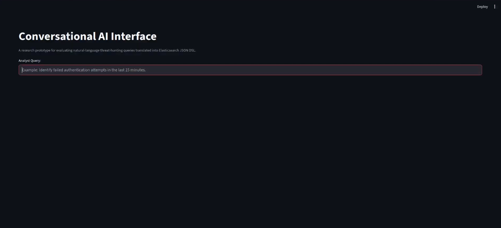
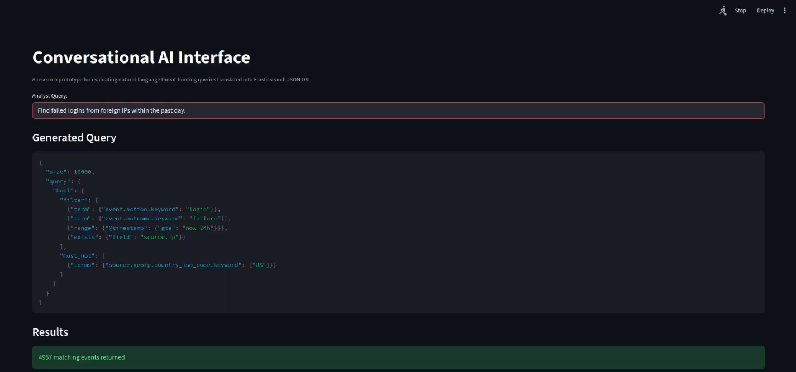
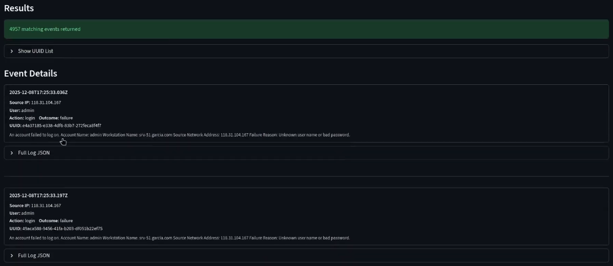

[Back to Portfolio](./)

Conversational AI Interface for Analyst-Driven Threat Investigation
===============

**Final Senior Project Report — December 11, 2025**

-   **Student:** Koi McFarland
-   **Major:** Computer Science and Engineering
-   **Degree:** Bachelor of Science in Computer Science and Engineering, Minor in Mathematics (Class of 2026)
-   **Project Advisor:** Professor Julie Henderson
-   **DoD/ACE Mentor:** Professor William Littleton
-   **Course:** CSCI 497–498–499 Senior Project (Capstone Series)
-   **Source Code Repository:** [Senior-Project](https://github.com/koi-mcfarland/Senior-Project)
    (Please [email me](mailto:kemcfarland@student.csuniv.edu?subject=GitHub%20Access) to request access.)
-   **Demonstration Video:** [CAI Walkthrough](https://www.youtube.com/watch?v=jT4mfJPEbIQ) (unlisted)

---

## 1. Statement of Purpose

Modern Security Operations Centers (SOCs) monitor, investigate, and respond to increasingly
complex cyber threats across large-scale enterprise environments that generate vast volumes of
log data. Platforms such as Elasticsearch provide powerful indexing and search capabilities, but
their effectiveness is constrained by how efficiently analysts can query and interpret the
underlying data.

**Problem.** SOC analysts must translate investigative intent into precise queries expressed in
Elasticsearch's JSON Domain-Specific Language (DSL). This translation step requires detailed
knowledge of field hierarchies, boolean logic, query structure, and time-range semantics, and
introduces three operational challenges:

-   **Inefficiency:** Writing, testing, and refining queries consumes valuable analyst time,
    particularly when syntax errors or incorrect field usage produce failed or misleading queries.
-   **Training bottlenecks:** New analysts require significant onboarding time to become
    proficient in the query language, creating scalability issues for growing SOC teams.
-   **Inconsistency:** Equivalent investigative questions may be expressed through different
    queries across analysts, reducing reproducibility.

This project investigates whether a **Conversational AI Interface (CAI)** can serve as an
effective, controlled intermediary between analysts and Elasticsearch — allowing analysts to
express threat-hunting intent in natural language while preserving the precision and safety
required for operational query execution.

**Research Question.** How can a Conversational AI interface specifically integrated with
Elasticsearch be designed to enable SOC analysts to query log data using natural language for
common adversarial threat-hunting tasks (e.g., failed logins, suspicious IPs, lateral movements)?

**Hypothesis.** If a CAI is developed and integrated with Elasticsearch to support
natural-language threat-hunting queries, then, when evaluated against a pre-tagged dataset
containing failed-login and lateral-movement events, it will achieve an overall F1 score of at
least 0.95 across all evaluated threat-hunting tasks.

## 2. Research & Background

This research is an **applied experimental study**: it introduces a proof-of-concept system and
measures its operational impact, rather than generating purely theoretical knowledge. It builds
upon and extends prior work in three areas:

- **Explainable AI and anomaly detection in cybersecurity** — prior systems apply machine
  learning to log anomaly detection, but rarely address the analyst-facing query layer.
- **Human–AI collaboration and trust in SOC environments** — effective augmentation keeps the
  human in authority; the CAI returns raw results without automated interpretation so the
  analyst remains responsible for investigative judgment.
- **Elasticsearch-based log analytics for threat detection** — the Elastic Common Schema (ECS)
  provides the standardized field structure that makes generated queries predictable and
  auditable.

The motivating gap in existing work is that SOC tooling effectiveness is limited not by data
availability or storage capability, but by the human effort required to interact with that data.
This study emphasizes quantitative evaluation against deterministic ground truth — controlled
synthetic datasets and objective precision/recall/F1 measurement — rather than subjective
usability claims. A full literature map is maintained in the project repository
(`docs/markdown/Preliminary-Literature-Map.md`).

## 3. Project Language, Software, and Hardware

**Language:** Python 3.11 (CAI application, log generator, and evaluation scripts).

**Software:**

| Component | Role |
|---|---|
| Streamlit | Web frontend for the analyst-facing CAI interface |
| Ollama + Mistral 7B (Q4_K_M) | Locally hosted LLM for natural-language → JSON DSL translation |
| Elasticsearch / Kibana 9.1.5 (Elastic Cloud Enterprise) | Log indexing, search, and SIEM platform |
| Filebeat | Scheduled log ingestion from generator node to Elasticsearch |
| Faker, psutil, maxminddb | Synthetic log generation and GeoIP classification |
| dstat | Resource/baseline metrics during test runs |

**Hardware / Infrastructure:** An AWS-based testbed of EC2 instances within a dedicated VPC
(10.120.16.0/20):

| Hostname | Role | Key configuration |
|---|---|---|
| ece-primary (10.120.16.100) | ECE Primary | RHEL 8.10, Podman containers (ES/Kibana 9.1.5) |
| ece-allocator (10.120.16.200) | ECE Allocator | RHEL 8.10, Podman |
| log-gen-workstation (10.120.16.10) | Log generator & Filebeat node | RHEL 8.10, Python 3.11, Faker, Filebeat |
| cai-node (10.120.29.230) | Conversational AI Interface | Ubuntu 22.04, Streamlit, Ollama, Mistral 7B |
| analyst-workstation | Analyst UI access | Web browser (Kibana + CAI) |

## 4. Project Requirements

**Functional requirements:**

1. A functional proof-of-concept CAI that accepts free-form natural-language threat-hunting
   queries through a web interface.
2. Integration with Elasticsearch: each accepted input must be translated into exactly one
   syntactically valid, read-only Elasticsearch JSON DSL query.
3. Support for at least two common threat-hunting tasks; the implemented scope covers three:
   failed authentication, suspicious/foreign IP activity, and lateral movement.
4. Schema constraints: generated queries may only reference known ECS fields present in the
   dataset, with explicit time-range filtering and bounded result sizes.
5. Safe failure: ambiguous or underspecified inputs must trigger a clarification request or a
   declined query — never a speculative or unrestricted query (e.g., no `match_all` scans).
6. Deterministic ground truth: all evaluation logs are synthetically generated with per-event
   UUID labels recorded in a PI-Key reference file, enabling exact precision/recall/F1 scoring.
7. Comprehensive audit: every CAI-generated query and Elasticsearch response is captured to
   raw run data (`data/raw/RUN-*`).

**Performance requirements:** F1 ≥ 0.95 (hypothesis benchmark); query latency under 5 seconds
target; detection accuracy above 90% for single-event threat patterns.

**Out of scope:** production deployment, alerting/remediation automation, adaptive learning from
execution feedback, human-analyst comparison, and any real PII/CUI or operational telemetry.

## 5. Project Implementation Description & Explanation

The implemented system consists of three coordinated services: a **SOC log generator**, the
**Elasticsearch testbed**, and the **Conversational AI Interface** itself.

The log generator (`services/soc-log-generator/`) is a Python application that writes ECS-compliant
events in NDJSON format. It produces both benign operational activity and deliberately injected
adversarial behaviors — brute-force failed logins, foreign/suspicious IP access, and multi-step
lateral movement chains (SSH/RDP/SMB host-to-host). Every event is assigned a globally unique
UUID, and its true semantic label is recorded in a separate reference file called the **PI-Key**,
which serves as exact, error-free ground truth. Logs are shipped into date-partitioned
Elasticsearch indices (`soc-logs-YYYY.MM.DD`) by Filebeat on a cron schedule, simulating
continuous log flow.

 
Fig 1. The CAI home screen (Streamlit) where an analyst enters a natural-language query.

The CAI (`services/conversational-ai-interface/`) operates as a natural-language-to-query
translation layer built in Streamlit. The analyst submits a free-form investigative question
(Fig 1). The application embeds the input into a rule-guided prompt template and sends it to the
locally hosted Mistral 7B model via Ollama (`components/ollama_client.py`). The prompt template
(`components/prompt.py`) constrains the model to emit exactly one Elasticsearch JSON DSL query
using only known ECS fields, read-only constructs, and explicit time ranges.

 
Fig 2. The CAI displaying the generated Elasticsearch JSON DSL for an analyst query.

Before execution, every model output passes a validation layer (`components/json_tools.py`) that
rejects malformed JSON, unknown fields, and unsafe constructs such as unrestricted index scans;
rejected inputs are replaced with a clarification request (`<<INVALID>>` path). Time expressions
in the prompt (e.g., "past 24 hours") are resolved deterministically by the timestamp resolver
(`components/timestamp.py`) rather than trusting the model to compute ranges. Validated queries
are executed against the ECE-hosted Elasticsearch cluster (`components/elasticsearch_client.py`),
and the returned log events are presented to the analyst without summarization — the analyst
remains fully responsible for interpreting results (Fig 3).

 
Fig 3. Query results returned to the analyst, with the raw events presented for review.

A companion evaluation script (`evaluate-results.py`) compares the UUIDs returned by each
CAI-generated query against the PI-Key, computing true positives, false positives, false
negatives, precision, recall, and F1 score for every test run. Because labeling logic is derived
from the same rules used to generate adversarial behavior, metric computation is exact and
repeatable; any observed error is attributable to the CAI's intent interpretation or query
construction, not to dataset ambiguity. The CAI deliberately does not learn from results or
iterate on execution feedback, so all observed performance reflects the model's initial reasoning
and prompt guidance.

The complete source code, testbed configuration, and raw run data are available in the project
repository: [github.com/koi-mcfarland/Senior-Project](https://github.com/koi-mcfarland/Senior-Project).

### 5.1 Project Demonstration

A narrated walkthrough of the CAI in action — entering a natural-language threat-hunting query,
viewing the generated Elasticsearch JSON DSL, and inspecting the returned log events:

<iframe width="560" height="315" src="https://www.youtube.com/embed/jT4mfJPEbIQ" title="Conversational AI Interface Demonstration" style="max-width:100%;" loading="lazy" allow="accelerometer; autoplay; clipboard-write; encrypted-media; gyroscope; picture-in-picture; web-share" referrerpolicy="strict-origin-when-cross-origin" allowfullscreen></iframe>

*(Unlisted video — viewable by anyone with the link: [youtube.com/watch?v=jT4mfJPEbIQ](https://www.youtube.com/watch?v=jT4mfJPEbIQ))*

## 6. Test Plan

Testing was conducted in the controlled testbed described in Section 3, following document
PTP-001. Entry criteria for every run: all EC2 instances active in the VPC, Elasticsearch/Kibana/
Filebeat confirmed running, PI-Key files generated, baseline resource usage stable for 5 minutes
(CPU < 5%, memory < 10%), and the CAI running.

Six test cases were defined:

| ID | Title | Objective | Success criteria |
|---|---|---|---|
| TC-001 | Baseline — CAI idle | Establish idle Elasticsearch behavior | CPU < 10%, no ES log anomalies |
| TC-002 | Failed login detection | Translate NL queries about failed logins into correct JSON DSL | Valid DSL; F1 ≥ 0.95; no unsafe expansion |
| TC-003 | Suspicious IP lookup | Generate correct DSL correlating foreign/suspicious IP events | F1 ≥ 0.95; no unrelated field broadening |
| TC-004 | Lateral movement chain detection | Detect multi-step RDP/SSH lateral movement | F1 ≥ 0.90; correct host-to-host correlation |
| TC-005 | Invalid/ambiguous query handling | Ensure malformed input fails safely | No unsafe query; no `match_all`; guardrails triggered |
| TC-006 | Linguistic robustness | Verify paraphrased equivalents yield consistent results | All DSL valid; same event set; avg F1 ≥ 0.95 |

For each test case the procedure was identical: issue the defined analyst input, capture the raw
CAI-generated JSON DSL, execute it against Elasticsearch, extract returned event UUIDs, compare
against PI-Key ground truth, and compute precision/recall/F1 with standardized tooling. Exit
criteria: all queries executed and logged, raw data copied to secured storage with hashes
recorded in the lab notebook, collection processes terminated, and Kibana dashboards exported.
Raw evidence for every run is archived in the repository under `data/raw/`.

## 7. Test Results

All executions (RUN-20251203-001 through RUN-20251208-004) completed with metrics computed
against PI-Key ground truth:

| Run | TC | Task | TP | FP | FN | Precision | Recall | F1 |
|---|---|---|---|---|---|---|---|---|
| 2025-12-03-001 | TC-001 | Baseline idle | — | — | — | — | — | Pass (CPU < 10%, no anomalies) |
| 2025-12-03-002 | TC-002 | Failed logins (24 h) | 5051 | 0 | 19 | 1.0000 | 0.9963 | **0.9981** |
| 2025-12-08-002 | TC-002 | Failed logins (2 h) | 364 | 1 | 33 | 0.9973 | 0.9169 | **0.9554** |
| 2025-12-08-003 | TC-003 | Foreign/high-risk IPs | 347 | 11 | 5 | 0.9693 | 0.9858 | **0.9775** |
| 2025-12-03-004 | TC-004 | Lateral movement | 3584 | 5068 | 0 | 0.4142 | 1.0000 | **0.5858** |
| 2025-12-08-004 | TC-004 | Lateral movement (refined) | 135 | 8 | 9 | 0.9441 | 0.9375 | **0.9408** |
| 2025-12-06-005 | TC-005 | Ambiguous input | — | — | — | — | — | Pass (clarification returned; no query generated) |
| 2025-12-07-006 | TC-006 | Paraphrase 1 | 208 | 0 | 19 | 1.0000 | 0.9163 | **0.9563** |
| 2025-12-07-006 | TC-006 | Paraphrase 2 | 198 | 0 | 19 | 1.0000 | 0.9124 | **0.9542** |
| 2025-12-07-006 | TC-006 | Paraphrase 3 | 241 | 0 | 0 | 1.0000 | 1.0000 | **1.0000** |
| 2025-12-07-006 | TC-006 | Paraphrase 4 | 220 | 0 | 0 | 1.0000 | 1.0000 | **1.0000** |
| 2025-12-07-006 | TC-006 | Paraphrase 5 | 218 | 0 | 0 | 1.0000 | 1.0000 | **1.0000** |

**Findings.**

- **Failed-login detection** met or exceeded the hypothesis threshold in every run (F1 0.9554–0.9981),
  with precision near unity — errors were small counts of missed events, not over-selection.
- **Suspicious/foreign IP activity** scored F1 0.9775, meeting the threshold; the CAI correctly
  constrained queries to IP fields and time windows.
- **Linguistic robustness** averaged F1 0.9821 across five paraphrases, all producing valid DSL and
  consistent result sets — evidence the CAI captures semantic intent rather than surface phrasing.
- **Lateral movement** was the weakest task. The initial run retrieved all true events (recall 1.0)
  but produced 5,068 false positives (F1 0.5858) by relying on broad categorical filters instead of
  precise protocol/sequence correlation. After prompt refinement, F1 improved to 0.9408 — a large
  gain, but still below the 0.95 hypothesis benchmark for this task.
- **Safety:** across all runs every executed query was syntactically valid DSL; no unrestricted
  index scans or prohibited constructs were observed, and ambiguous input reliably triggered
  clarification (TC-005).

**Hypothesis evaluation:** the ≥ 0.95 F1 target was met for all single-event threat patterns but
not for the multi-stage lateral-movement task. The hypothesis is therefore supported for
well-defined, single-event threat hunting and not supported for sequence-dependent behaviors
under the current static-query architecture. The system is assessed at **Technology Readiness
Level 4** (component integration validated in a laboratory environment).

## 8. Challenges Overcome

- **Schema-level correctness of generated queries.** Early runs failed on Elasticsearch
  technicalities rather than misinterpreted intent — e.g., querying `country_iso_code` instead of
  the required `country_iso_code.keyword` subfield, or placing a time `range` clause outside
  `bool.filter`. These were resolved by tightening the prompt's explicit DSL placement rules and
  by re-validation; field placement rules became hard constraints in the prompt template.
- **Lateral movement over-selection.** The model expressed multi-stage behavior with broad
  authentication/network filters, generating thousands of false positives. Constraining the prompt
  with worked examples mirroring the target phrasing and adding foreign-IP filtering reduced
  false positives from 5,068 to 8, though at the cost of some recall. This remains an
  architectural limitation (single static queries cannot encode sequence/correlation logic), not
  an implementation error.
- **Ground-truth measurement without labeled real data.** Real SOC telemetry cannot be objectively
  labeled, so F1 scoring against it would be ambiguous. Solved by generating fully synthetic,
  deterministically labeled logs with the PI-Key mapping, validated by confirming canonical
  reference queries return UUID sets that exactly match PI-Key entries.
- **Environment and ingestion automation.** Continuous, reproducible log flow into Elasticsearch
  required wiring Filebeat to the NDJSON output on cron-managed schedules with index partitioning
  (`soc-logs-YYYY.MM.DD`) mirroring real SIEM deployments.
- **Safety vs. usefulness trade-off.** Ensuring ambiguous inputs never produced speculative
  queries required the `<<INVALID>>` clarification path plus rejection rules (no `match_all`, no
  unbounded result sizes), which had to be balanced against generating useful queries for terse
  but legitimate analyst inputs.

## 9. Future Enhancements

- **Schema awareness and validation feedback:** expose the live index mapping to the CAI and add a
  structured execution feedback loop so it can self-correct field-placement errors instead of
  requiring manual prompt refinement.
- **Correlation-aware querying:** extend beyond a single static DSL query — multi-query plans,
  sequence/correlation constructs (EQL), or post-retrieval reasoning — to properly support
  multi-stage behaviors such as lateral movement.
- **Analyst-in-the-loop evaluation (path to TRL-5/6):** validate against realistic or historical
  sanitized SOC datasets, then measure time-to-detection and cognitive-workload reduction with
  real analysts in a simulated operational environment.
- **Expanded threat coverage:** additional adversarial patterns (persistence, exfiltration,
  privilege escalation) and broader paraphrase suites to stress-test robustness.
- **Production SIEM workflow integration (TRL-7+):** sustained performance under operational load,
  with continuous feedback loops — explicitly out of scope for this study.

## 10. Defense Presentation Slides

The final defense presentation (CSCI 499, December 11, 2025) is available here:

**[View Defense Slides (PDF)](/pdf/defense-slides.pdf)**

---

[Back to Portfolio](./)
